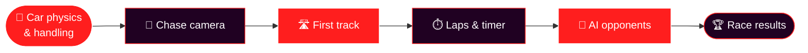

  

  

  
  
  
  

---

<h2 align="center">🏁 THE PLAN</h2>

An arcade <b>racing game</b> built in <b>Unity</b>: fast, physical and fun to drive. 
This repository is the starting line. Code and assets are on their way. 🛠️

---

<h2 align="center">🗺️ ROADMAP</h2>

- [ ] 🚗 Car physics and handling
- [ ] 🎥 Chase camera
- [ ] 🛣️ First race track
- [ ] ⏱️ Laps, checkpoints and timer
- [ ] 🤖 AI opponents
- [ ] 🏆 Race results screen

---

  ⭐ <b>Star the repo</b> to follow the build!  
  <b>Made with ❤️ and 🏎️ by <a href="https://github.com/vishwaMoger">Vishwa Moger</a></b> 
  Game Developer · 3+ years · Bangalore, India

